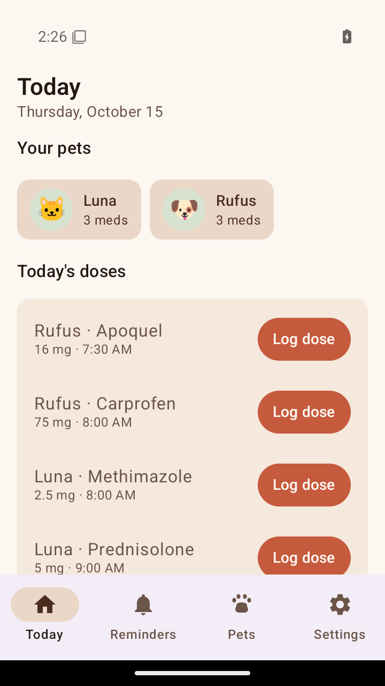
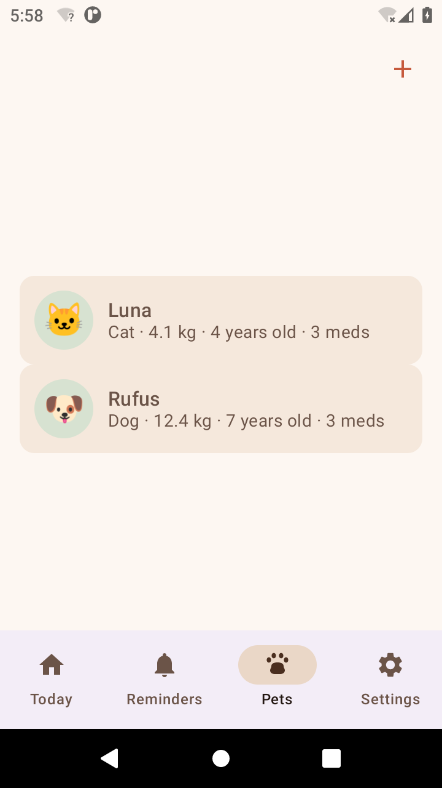
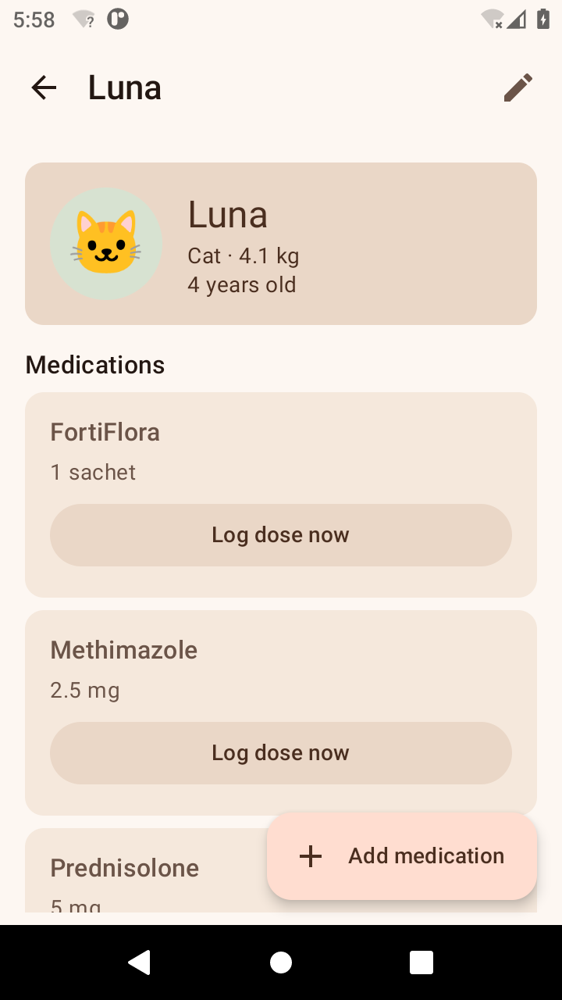
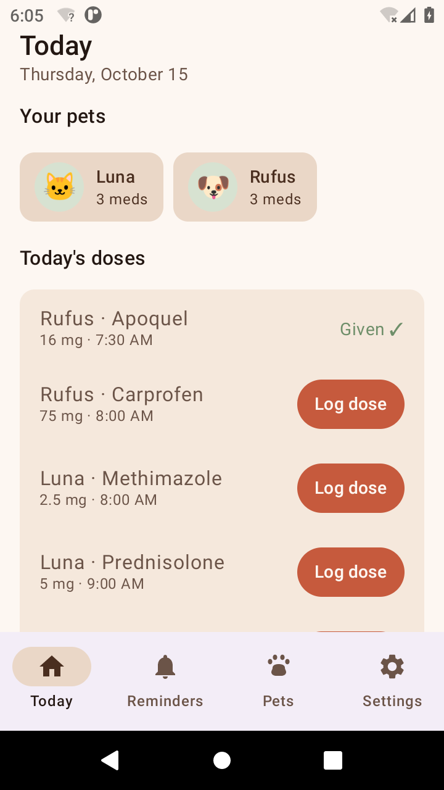
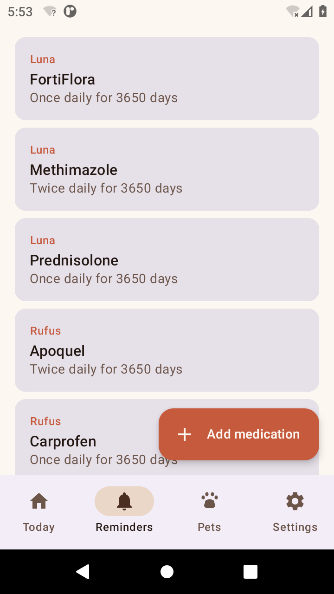
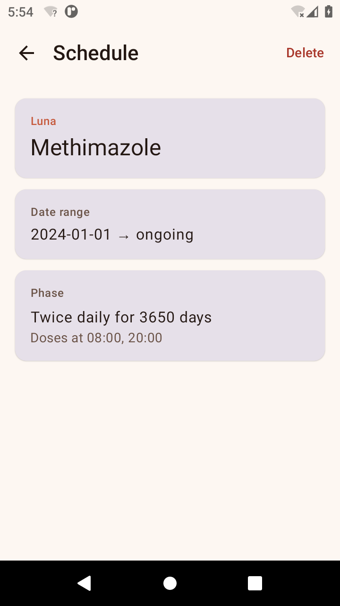
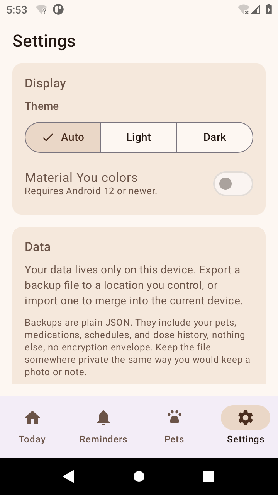
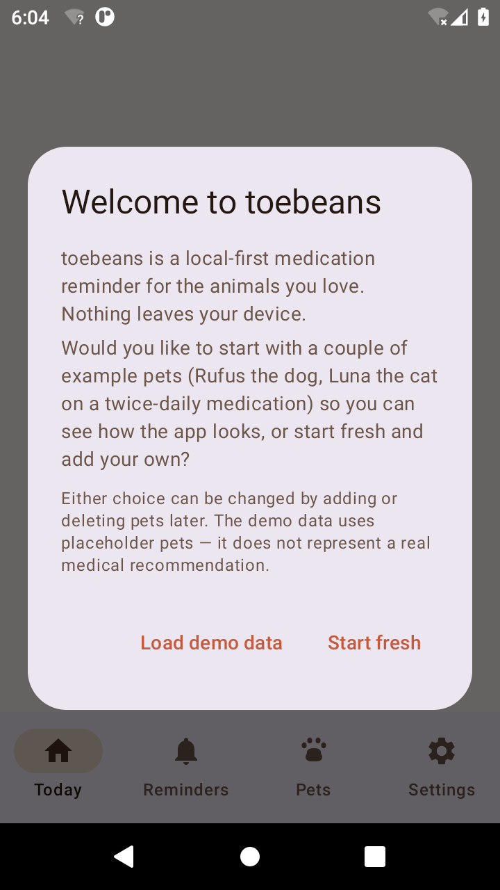

# toebeans

Pet medication tracker for Android. Local-only. No cloud, no telemetry, no
third-party services.

Status: Milestone 1 feature complete, Milestone 1.2 internal beta prep. Bottom
nav is **Today, Reminders, Pets, Settings, History**. Pets, medications,
schedules, and dose events live in SQLDelight (`toebeans.db`) in app-private
storage. Today logs doses. Reminders lists schedules and opens read-only
schedule detail. History is a read-only, newest-first 30-day log of dose events
in every status.

Dose alarms fire through AlarmManager over a 72-hour horizon. After a reboot,
`BootReceiver` replays alarms for pending rows in that horizon. Editing a
schedule recycles only its pending dose rows, so given, skipped, and missed
history stays. Deleting a schedule keeps its dose history as well; the fire
path ignores orphaned rows, so no alarm survives the delete.

Testers install from the F-Droid path. The steps are in
[docs/fdroid-tester-tutorial.md](docs/fdroid-tester-tutorial.md).

## Design review

Static HTML/CSS previews for visual sign-off. The terracotta-warm pack is signed off and the shipped Compose theme matches it; the lab stays the place to try layout or color variants before touching `Theme.kt`.

- [Style lab](docs/style-lab/index.html): toggle variant packs (terracotta-warm, sage-calm, high-contrast) and record the choice in [DECISIONS.md](docs/style-lab/DECISIONS.md).
- The design handoff pipeline is local-only: `docs/design-handoff/manifest.yaml` maps screens to Compose paths, and `bash scripts/style_lab_handoff_check.sh` fails a UI change whose Kotlin sources are newer than the lab.
- **terracotta-warm** signed off 2026-05-26. Shipped Compose theme (PR [#54](https://github.com/weijia-89/toebeans/pull/54)): Today **Log dose** filled primary pill, **Given ✓** sage tertiary, dark `Theme.kt` tune. Material You toggle stays default off.

```bash
bash scripts/manual_qa_boot.sh fresh --open-style-lab
```

<p align="center">
  
</p>

## What it does today

* Add pets with weight and birthdate, plus a free-text notes field.
* Add medications underneath each pet.
* Define a schedule from a medication row (start date, dose times, doses per
  day), and edit an existing schedule without losing its dose history.
* On **Today**, tap **Log dose** on a due row to record that dose.
* On a pet's detail screen, tap **Log dose now** on a medication row (the same
  underlying dose log).
* See relative last-dose labels on medication rows (`just now`, `2h ago`,
  `yesterday`, `on May 13`, and so on).
* Read the **History** tab: status, local scheduled time, and whether the alarm
  fired, newest first across every pet.
* See the static **emergency resources card** on Today and in Settings. It
  carries curated poison-control hotlines that open the dialer and
  find-a-vet guidance, with no-medical-advice framing (PR
  [#159](https://github.com/weijia-89/toebeans/pull/159)).
* Load demo data on first launch, or start with an empty database. Settings has
  a **Remove demo data** action that cancels pending demo alarms and deletes
  the demo pets, medications, schedules, and dose rows (PR
  [#154](https://github.com/weijia-89/toebeans/pull/154)).
* Theme picker (Auto / Light / Dark). Optional Material You dynamic color on
  Android 12 and up.

<p align="center">
  
  &nbsp;
  
  &nbsp;
  
</p>

On **Today**, tap **Log dose** on the morning row. The dose moves to **Given ✓**
and the same entry shows under **Logged today**.

The **Reminders** tab lists active schedules. Tap a row for schedule detail
(phases, dose times, delete). **Settings** has the theme picker, Material You
toggle, JSON export/import, the emergency resources entry, and a Diagnostics
card for the local crash log.

If notifications are denied, or a fired dose never showed its notification,
Today says so: the app records the fire in the database, appends a line to the
local crash log, and shows a denial banner with a tap-through to Settings. The
delivery audit lives in the `NotificationAudit` table.

<p align="center">
  
  &nbsp;
  
  &nbsp;
  
</p>

## What it deliberately doesn't do

The app has no symptom checker. There are no drug-interaction warnings, no
dose-safety checks, no diagnostic content of any kind. The app is not a vet
and the design refuses to act like one. No AI feature is allowed; reference
text reaches the app only from an approved human source with a per-item
approval record under [ADR-0019](docs/adr/0019-vet-recommended-content-framework.md).

It also doesn't talk to the network. No cloud sync. No analytics. No crash
reporting either. A CI check fails the build if a network library shows up
in the dependency graph at all.

## Stack

Kotlin 2.4.21, Compose Multiplatform 1.12.2, AGP 9.5.1, and Gradle 9.9.0. The
KMP `shared` module owns domain models and repository contracts; the schedule
calculator (a pure function from `Schedule` phases to `ScheduledDose` values for
a window) ships there. SQLDelight 2.4.1 backs on-device storage and Koin wires
the view models. Reminder firing uses AlarmManager with a WorkManager fallback;
`DoseAlarmReceiver` looks up the dose, posts the notification, and records the
ADR-0011 denial audit path. `BootReceiver` re-schedules the 72-hour horizon in
the receiver process.

The Android app has minSdk 26 (Android 8.0), targetSdk 34, and compileSdk 35.

The shared test suite uses failing tests as specs. Two tests on `main` are red
by design and pin future work: the vet-visit and vaccine schema
(#160) and the travel-mode home timezone
(#161). They are not shipped behavior. See
[docs/ROADMAP.md](docs/ROADMAP.md) for their status.

## Install for testers

Testers install from the F-Droid path.
The steps are in [docs/fdroid-tester-tutorial.md](docs/fdroid-tester-tutorial.md).

## Build

You need JDK 17 and an Android SDK at API 35 or later.

```bash
brew install openjdk@17
export JAVA_HOME="/opt/homebrew/opt/openjdk@17/libexec/openjdk.jdk/Contents/Home"
export ANDROID_HOME="$HOME/Library/Android/sdk"
./gradlew :androidApp:installDebug
```

To run the shared-module tests without an Android SDK:

```bash
./gradlew :shared:jvmTest --console=plain
```

Refresh README screenshots on a booted `toebeans-pixel7` AVD after
`installDebug`:

```bash
./scripts/capture_readme_screenshots.sh
```

## Repository layout

```
toebeans/
  shared/      KMP shared module (models, SQLDelight, calculator)
  androidApp/  Android app: Compose UI, AlarmManager notifications
  docs/
    adr/         Short architecture decisions (MADR format)
    style-lab/   Static HTML variant packs for design sign-off
    screenshots/ Emulator captures embedded in this README
    ARCHITECTURE.md
    ROADMAP.md
  scripts/     Build helpers, CI checks, screenshot capture
```

## Contributing

Read [CONTRIBUTING.md](CONTRIBUTING.md) for the pre-push gauntlet and
[AGENTS.md](AGENTS.md) for the load-bearing contract.

## Security and privacy

Every record lives in app-private storage. Nothing leaves the device. There
is no opt-in or opt-out for telemetry because there is none to opt into. The
threat model is in [SECURITY.md](SECURITY.md).

The first-launch dialog states the local-only posture in plain language and
lets you load demo data or start with an empty database.

<p align="center">
  
</p>

## Open questions

- The two red-by-design tests above still need their implementation slices.
  The operator has not scheduled either one.
- GitHub Actions `ci` was reported as `startup_failure` with zero jobs. Local
  verification is the current gate until a human fixes the workflow.
- PR 166 removed the em-dash fitness gate at the operator's direction. Voice
  consistency now depends on review rather than a mechanical check.

## License

[AGPL-3.0-or-later](LICENSE).
